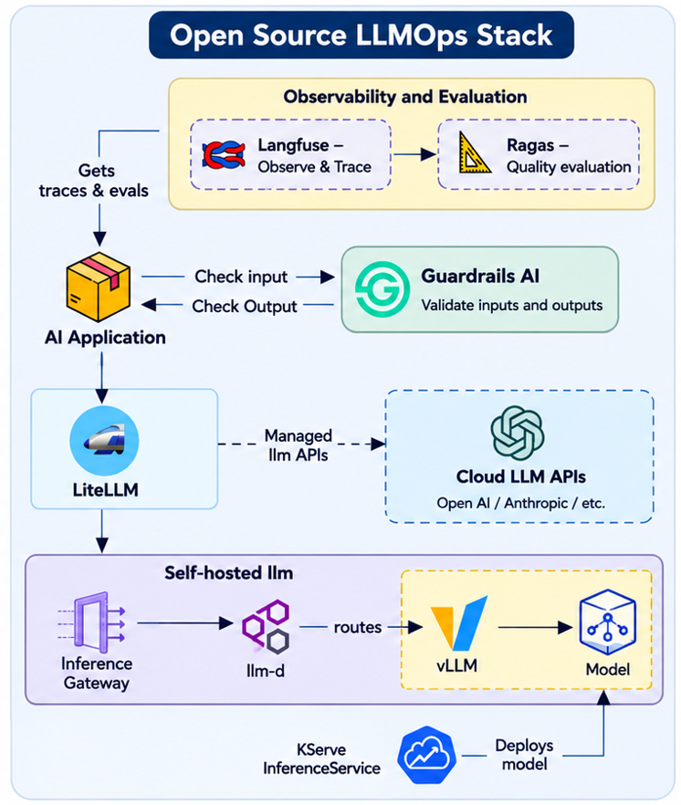

# The Open Source LLMOps Stack




```
            ┌──────────────────────────── app-pool ─────────────────────────────┐
 client ──► │ LiteLLM ──(pre/post)──► Guardrails AI      Ragas Job ──► LiteLLM  │
            │    │  └── every call ──► Langfuse v4 (self-hosted) ◄── scores ───┘ │
            └────┼──────────────────────────────────────────────────────────────┘
                 ├── gemini / gemini-embedding ──► Vertex AI (Workload Identity, no key)
                 └── qwen-cpu ──► GKE Inference Gateway (internal ALB, gke-l7-rilb)
                                     └─► llm-d EPP (prefix-aware) ─► InferencePool ─► vLLM CPU pods (model-pool, C3)
                                         phase C: KServe LLMInferenceService creates EPP + pool + vLLM
```

| Phase | What you get | Done when | Time | Cost while up |
| --- | --- | --- | --- | --- |
| **A** | GKE + vLLM CPU (2 pods) + llm-d behind the GKE Inference Gateway | `a16` shows real answers and the 2×2 routing table with prefix-cache hit rates | ~40 min | ~US$1/hr |
| **B** | Langfuse v4, LiteLLM (Qwen + Gemini), Guardrails AI, Ragas | `b16` passes all checks; `b17` prints Ragas scores that also appear in Langfuse | ~45 min | +~US$0.3/hr + Vertex tokens |
| **C** | KServe LLMInferenceService takes over model deployment | `c14` passes the phase A and B checks unchanged | ~40 min | +2 C3 nodes during the switch |

Costs are rough estimates (us-central1); check the pricing calculator. Use `90-pause.sh` between sessions.

## Before you start

- Run everything from **Cloud Shell** (has gcloud, kubectl, helm, jq, git, envsubst). WSL also works if
  gcloud/kubectl/helm are installed there: everything is userspace, and images are built by Cloud Build,
  so the blocked `docker pull` doesn't matter.
- Your account needs Owner (or equivalent) on the project. Billing enabled.
- **CPU quota:** peak use is about 4 + 8×`MODEL_NODES_MAX` + 8×`APP_NODES_MAX` vCPUs (52 with defaults),
  including C3 CPUs. `00-preflight.sh` checks it.

```bash
# in Cloud Shell
unzip llmops-stack-gcp.zip && cd llmops-stack/gcp
cp .env.example .env && chmod 600 .env
# edit .env: PROJECT_ID, REGION/ZONE, LANGFUSE_ADMIN_EMAIL (LITELLM_SHA256 is the hash you verified locally)
gcloud config set project vish-aiops
bash scripts/00-preflight.sh
```

## Phase A — GKE, real vLLM CPU, llm-d behind the GKE Inference Gateway

| Step | Script | What it does |
| --- | --- | --- |
| 1 | `a10-project-setup.sh` | Enables APIs, creates the **proxy-only subnet** the internal ALB needs, creates the Artifact Registry repo |
| 2 | `a11-cluster.sh` | Zonal GKE cluster with `--gateway-api=standard` + Workload Identity; tainted `model-pool` of `c3-standard-8` (2..4 nodes). ~10 min |
| 3 | `a12-llm-d-repo.sh` | Clones llm-d `release-1.0`, adds this bundle's **Qwen3-0.6B CPU overlay** on top of llm-d's CPU base, checks the InferencePool CRD (GKE ≥ 1.34.0-gke.1626000 manages it) |
| 4 | `a13-gateway.sh` | `Gateway llm-d-inference-gateway`, class `gke-l7-rilb` (internal, no public IP). Waits for PROGRAMMED |
| 5 | `a14-router.sh` | llm-d router in **gateway mode** (`llm-d-router-gateway`, `provider.name=gke`): EPP + InferencePool + HTTPRoute + GKE health-check/backend policies. Same values files as your local run, plus `values/router-gke.values.yaml` |
| 6 | `a15-vllm.sh` | 2 vLLM CPU pods (`vllm-openai-cpu:v0.31.0`, 6 vCPU / 16 GiB each, prefix caching on). 5–10 min first time |
| 7 | `a16-test-routing.sh` | **Done-check:** one real answer through the Gateway, then the 2×2 from your local demo (plain Service vs llm-d, shared vs distinct prefix) with **vLLM's prefix-cache hit rate** per pod |

Pods running:

```
$ kubectl get pods -n llmd
NAME                                                  READY   STATUS    RESTARTS   AGE
optimized-baseline-cpu-vllm-decode-6b74c5787f-6ncw9   1/1     Running   0          3m23s
optimized-baseline-cpu-vllm-decode-6b74c5787f-prfdw   1/1     Running   0          3m23s
qwen-router-epp-74b8f8c85b-ffc4p                      1/1     Running   0          4m53s
```
What `a16` should show (shape, not exact numbers):

```
K8s Service    shared prefix      8/8 HTTP 200   requests per pod: 3 5   prefix-cache hit rate per pod: 70% 78%
K8s Service    no shared prefix   8/8 HTTP 200   requests per pod: 4 4   prefix-cache hit rate per pod: 0% 0%
llm-d Gateway  shared prefix      8/8 HTTP 200   requests per pod: 8 0   prefix-cache hit rate per pod: 94% -
llm-d Gateway  no shared prefix   8/8 HTTP 200   requests per pod: 5 3   prefix-cache hit rate per pod: 0% 0%

Output snapshot:
$ bash scripts/a16-test-routing.sh

==> Client pod and plain Service (the control: no llm-d in the path)
  [ok]   curl-client pod + Service vllm-direct (same pods, kube-proxy only)

==> 1 question through the Gateway (http://10.128.0.13)
  [ok]   real answer from Qwen/Qwen3-0.6B:
     Self-attention in a Transformer is a mechanism that allows the model to weigh different parts of 
     the input based on their relevance to the current task. It enables the model to focus on specific 
     parts of the input when processing long sequences by dynamically computing weighted representations 
     from the input.
  usage: {"prompt_tokens":26,"total_tokens":81,"completion_tokens":55,"prompt_tokens_details":null,"completion_tokens_details":null}

==> Routing comparison (8 requests per row; CPU prefill takes a few seconds each)
  pods: optimized-baseline-cpu-vllm-decode-6b74c5787f-6ncw9 optimized-baseline-cpu-vllm-decode-6b74c5787f-prfdw
==============================================================================================================
K8s Service    shared prefix        8/8   HTTP 200    21s   requests per pod: 6 2       prefix-cache hit rate per pod: 81% 48%
K8s Service    no shared prefix     8/8   HTTP 200     9s   requests per pod: 6 2       prefix-cache hit rate per pod: 0% 0%
llm-d Gateway  shared prefix        8/8   HTTP 200     9s   requests per pod: 8 0       prefix-cache hit rate per pod: 97% -
llm-d Gateway  no shared prefix     8/8   HTTP 200     8s   requests per pod: 5 3       prefix-cache hit rate per pod: 0% 0%
==============================================================================================================
  How to read it:
  - K8s Service rows look alike: kube-proxy never sees the prompt, so a shared prefix changes nothing
    about where requests land.
  - llm-d + shared prefix: (almost) all requests on one pod. The prefix is computed once and every
    later request hits the cache.
  - K8s Service + shared prefix still shows cache hits, but every pod must compute the prefix once
    first (one cold prefill per pod instead of one in total). With 2 pods the gap is modest; with
    more pods and more concurrent conversations the wasted prefills, and the latency, grow.
  - llm-d + no shared prefix: spread across pods again (token-load scorer), no cache hits.
  - Hit rate = vLLM prefix_cache_hits / prefix_cache_queries (tokens) during that row.
```

With only 2 pods the Service still gets cache hits, because each pod computes the prefix once and then
reuses it. llm-d computes it once in total and keeps the conversation together. That's the difference to
point at. It grows with more pods and more concurrent conversations.

## Phase B — Langfuse, LiteLLM + Vertex AI, Guardrails AI, Ragas

| Step | Script | What it does |
| --- | --- | --- |
| 1 | `b10-app-layer-setup.sh` | `app-pool` (e2-standard-8, 1..2), namespaces, **Workload Identity** binding (`ns/llmops/sa/litellm` → `roles/aiplatform.user`), Cloud Build SA, nodes may pull from Artifact Registry |
| 2 | `b11-operators.sh` | cert-manager + ClickHouse operator (needed by the Langfuse v4 chart; KServe reuses cert-manager) |
| 3 | `b12-langfuse.sh` | Langfuse chart 2.2.4 (Langfuse v4), single replicas. **Headless init** creates org, project, API keys and your admin login; secrets are generated into `run/langfuse.env` |
| 4 | `b13-build-images.sh` | Cloud Build → Artifact Registry: **litellm** (wheel SHA-256 verified *inside* the build), **guardrails**, **ragas**. Deployed by digest |
| 5 | `b14-guardrails.sh` | Guardrails AI server with three guards, checked directly |
| 6 | `b15-litellm.sh` | LiteLLM with `qwen-cpu` (→ Gateway), `gemini` + `gemini-embedding` (→ Vertex AI), guardrails on, Langfuse callback, fallback `qwen-cpu → gemini` |
| 7 | `b16-smoke-test.sh` | **Done-check:** Qwen answers, Gemini answers, embeddings, PII masked before the model, banned topic → 400, every call found in Langfuse |
| 8 | `b17-ragas.sh [models]` | Ragas Job: the 6-question test set goes to each model through LiteLLM; Gemini judges `faithfulness`, `answer_relevancy`, `factual_correctness`; scores are attached to the traces |

Open Langfuse: `kubectl port-forward -n langfuse svc/langfuse-web 3300:3000` → <http://localhost:3300>
(login in `run/langfuse.env`). Port 3300 avoids your local Langfuse. In Cloud Shell use Web Preview → port 3300.

**The guards** (`images/guardrails/config.py`, custom validators, no Hub token or large models):

| Guard | LiteLLM hook | Effect |
| --- | --- | --- |
| `topic-guard` | pre_call | prompt mentions a banned topic → HTTP 400 |
| `pii-mask-guard` | pre_call | e-mail addresses and card-like numbers replaced by `<EMAIL>` / `<CARD_NUMBER>` before any model sees them |
| `output-guard` | post_call | the model's answer contains PII → HTTP 400 |

## Phase C — KServe takes over model deployment

| Step | Script | What it does |
| --- | --- | --- |
| 1 | `c10-kserve-install.sh` | KServe v0.21 LLMInferenceService controller: CRDs, controller (`createGIECRDs=false`, since GKE owns the InferencePool CRD), config presets. No Istio or Envoy Gateway: the GKE Gateway is reused |
| 2 | `c11-llmisvc.sh` | `LLMInferenceService qwen3`: KServe creates the vLLM pods, its EPP and `qwen3-inference-pool`. The HTTPRoute is created by this bundle and **header-gated** (`x-llm-backend: kserve`), so phase A keeps serving everything else. Adds the GKE health-check policy |
| 3 | `c12-test-kserve.sh` | Phase A's 2×2 against the KServe pods (via the header) |
| 4 | `c13-switch.sh` | KServe route serves `/`, the llm-d chart's route is removed, the phase A Deployment is scaled to 0. `--rollback` goes back; `--remove-phase-a` deletes phase A for good |
| 5 | `c14-verify.sh` | **Done-check:** routing comparison + phase B smoke test, unchanged. Then optionally `b17-ragas.sh qwen-cpu` |

LiteLLM never changes: it calls the same Gateway address with the same model name throughout.

## Pause, resume, tear down

```bash
bash scripts/90-pause.sh       # model + app pools to 0 nodes (data kept)
bash scripts/91-resume.sh      # back, waits for pods
bash scripts/99-teardown.sh    # delete the cluster (asks to confirm); --all also removes AR repo, subnet, SA, IAM
```

## Files

| Path | Purpose |
| --- | --- |
| `.env.example` | all settings |
| `scripts/` | `00` preflight · `a1x` phase A · `b1x` phase B · `c1x` phase C · `9x` pause/resume/teardown · `lib.sh` helpers |
| `manifests/phase-a/vllm-qwen-cpu/` | kustomize overlay copied into the llm-d repo (Qwen3-0.6B on C3) |
| `values/router-gke.values.yaml` | shrinks the EPP to 0.5 CPU / 1 GiB |
| `manifests/phase-b/` | Langfuse values, Guardrails, LiteLLM, Ragas Job |
| `manifests/phase-c/` | LLMInferenceService, HTTPRoute, GKE policies |
| `config/litellm.config.yaml.tmpl` | LiteLLM models, guardrails, Langfuse, fallback |
| `images/` | Dockerfiles + `cloudbuild.yaml`; `guardrails/config.py` (guards) + `middleware.py`; `ragas/evaluate.py` + `testset.jsonl` |
| `run/` | generated at run time: secrets, rendered config, image digests (git-ignored) |

## Troubleshooting

| Symptom | Cause | Fix |
| --- | --- | --- |
| `a11`: quota error | Not enough (C3) CPUs in the region | Lower `MODEL_NODES_MAX`, or request quota |
| `a13`: Gateway never PROGRAMMED | No proxy-only subnet in the region | Re-run `a10`; `kubectl describe gateway -n llmd` |
| `a16`: no answer, HTTP 503 | Backends unhealthy right after start | Wait 1–2 min; `kubectl describe httproute -n llmd` |
| vLLM pod `OOMKilled` | KV cache + model + workspace > 24 GiB | Lower `VLLM_CPU_KVCACHE_SPACE` in the overlay |
| vLLM pod Pending | `model-pool` at max, or the taint missing a toleration | `kubectl describe pod`; raise `MODEL_NODES_MAX` |
| `b12`: API keys rejected | Headless init didn't run (env not picked up) | `kubectl logs -n langfuse deploy/langfuse-web \| grep -i init` |
| `b13`: permission denied on the build | Cloud Build SA roles not propagated yet | Wait a minute, re-run (built images are skipped) |
| `b13`: litellm build fails at `sha256sum -c` | Hash doesn't match the wheel pip picked | That's the safety check working. Verify the hash for the printed wheel name |
| `b16` gemini: 403 | Workload Identity binding missing or still propagating | Re-run `b10`; wait 1–2 min |
| `b16` gemini: 404 model | Model not offered in `VERTEX_LOCATION` | Gemini 3.x uses `global`; check the Vertex AI model list |
| `b16` qwen: HTTP 500 mentioning `llmOutput` / prompt | Guardrails image built without `middleware.py` | Rebuild with `b13` |
| `b17`: all metrics fail with `InstructorRetryException` | The judge returned invalid structured output | Check `kubectl logs -n llmops deploy/litellm`; try another `VERTEX_CHAT_MODEL` |
| `c11`: not Ready | Model download or webhook issue | `kubectl describe llminferenceservice qwen3 -n llmd`; `kubectl logs -n kserve deploy/llmisvc-controller-manager` |
| `c13`: traffic not switching | GKE LB reprogramming | Wait; `kubectl get httproute -n llmd -o yaml` (Accepted/ResolvedRefs) |

## What was tested, and what wasn't

Tested here, without GCP access:

- All scripts pass `bash -n` and `shellcheck`. Every gcloud flag used exists in gcloud 570.
- Every manifest renders with no leftover placeholders. All Kubernetes and GKE objects pass `kubeconform --strict`. The LLMInferenceService passes KServe v0.21's own CRD schema with unknown fields rejected. The vLLM overlay builds with kustomize 5.8 on the real llm-d `release-1.0` base.
- The Guardrails server (guardrails-ai 0.11.0 / guardrails-api 0.4.4) ran with this config and middleware. LiteLLM 1.108.4 ran with this config against it (mock model upstream): masking, banned-topic 400, output-PII 400, Qwen `enable_thinking=false` passthrough, and non-root start all work.
- The Ragas job ran against the same sandbox stack. Answers, trace IDs and guardrail spans reached a mock Langfuse, and metric failures were handled cleanly.
- `a16` ran end to end against a mock router with per-pod prefix-cache counters. `b13` ran against a fake gcloud, including the comma-safe substitutions and the digest capture. The LiteLLM Dockerfile's hash check accepts the right wheel and rejects a wrong hash.

Found and fixed during testing:

- LiteLLM sends `llmOutput` but guardrails-api 0.4.4 expects `llm_output`, which produced HTTP 500. The middleware renames the key.
- An exception-style guard made LiteLLM let blocked prompts through. All blocking guards now use NOOP.
- A combined guard hid the banned-topic failure behind the masking fix. Now there's one validator per guard.
- Ragas 0.4.3 breaks with the newest langchain-community. It's pinned below 0.4.
- Gemini 2.5 was retired on Vertex on 2026-10-20. The default is now `gemini-3.5-flash`.

Not tested (needs your project): GKE, the GKE Gateway/InferencePool behaviour, vLLM on C3, Langfuse chart
2.2.4, Cloud Build, Vertex AI calls, Ragas with a real Gemini judge, and KServe on GKE. The steps most likely
to need a tweak on the first run: Langfuse headless init (`b12`), the Ragas judge's structured output with
Gemini (`b17`), and KServe's controller with GKE's Gateway (`c11`).
